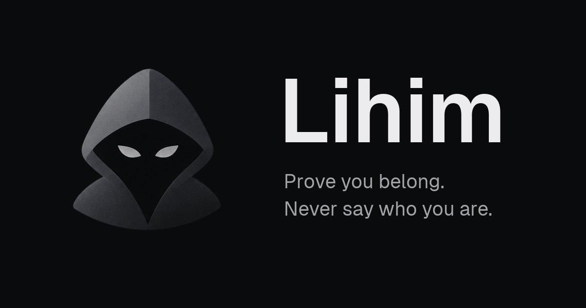

<p align="center">
  
</p>

<h1 align="center">Lihim</h1>

<p align="center">
  <strong>Prove you belong. Never say who you are.</strong><br />
  Passkey → per-group Semaphore identity → an anonymous, recountable answer on Stellar
</p>

<p align="center">
  Anonymous polls for small groups. Only members can answer, each member answers one time, and
  not even the admin can tell who said what. Every answer is a Semaphore V4 zero-knowledge proof
  checked by a Soroban contract on <a href="https://stellar.org">Stellar</a>, so anyone can count
  the result again from chain data.
</p>

<p align="center">
  <a href="https://lihim.vercel.app"></a>
  <a href="./lihim-SPEC.md"></a>
  <a href="./contracts/INTERFACE.md"></a>
  <a href="./packages/sdk/README.md"></a>
</p>

<p align="center">
  <a href="https://stellar.expert/explorer/testnet/contract/CA2IH7CXYSVVYS6JI3D3XPTXS3F2HH7F64FZNFXSHYAT2T4QU4TR23D6"></a>
  <a href="https://stellar.expert/explorer/testnet/contract/CB6BG5NTMGK2MW33FGA2E4Q3DFU2LE5FPYV5HAJ425ZJX43OLUZRCWJW"></a>
</p>

<p align="center">
  
  
  
  
  
  
  
  
  
  
</p>

<p align="center">
  <a href="https://lihim.vercel.app"></a>
</p>

> **Status: Stellar testnet.** The full flow (passkey sign-up, groups, invites, on-chain members,
> polls and anonymous answers through the relay) was tested end to end in real browsers on
> 2026-10-24. The contracts are **not audited**, and the testnet polls contract allows groups of 2
> for testing. See [Roadmap](#roadmap) for what is left before real use.

---

## Contents

- [Try it](#try-it) · [Problem](#problem) · [Solution](#solution) · [Features](#features)
- [How the proof works](#how-the-proof-works) · [What it proves](#what-it-proves) · [Architecture](#architecture)
- [Deployed contracts](#deployed-contracts) · [Contract interface](#contract-interface)
- [Quick start: app](#quick-start--app) · [Quick start: contracts](#quick-start--contracts) · [SDK](#sdk)
- [Tech stack](#tech-stack) · [Repository layout](#repository-layout) · [Testing](#testing)
- [Product rules](#product-rules) · [Roadmap](#roadmap) · [Documentation](#documentation)

## Try it

1. Open **[lihim.vercel.app](https://lihim.vercel.app)** and sign up with a passkey (Face ID,
   fingerprint or device PIN). There is no password, wallet or seed phrase. The passkey must
   support the WebAuthn PRF extension: Google Password Manager and iCloud Keychain do; Brave's
   local passkey store does not.
2. Create a group and share its invite link. Each person who joins gets a new identity for this
   group, and only its public commitment goes on-chain.
3. Create a poll (single choice, yes/no or a 1–5 rating). The contract freezes the member tree.
4. Answer. Your browser builds a zero-knowledge proof in about one second and a relay sends it.
5. Open the poll's public **verify** page (`/verify/[pollId]`). It counts the answers again from
   Stellar, with no sign-in.

## Problem

Small groups (student orgs, HOAs, class groups, ministries) need honest answers, but members
can't afford to be identified, and the result has to be trusted:

- **Anonymous but open.** An anonymous form lets anyone with the link answer, any number of times.
- **Verified but exposed.** A sign-in form gives one answer each, but the admin sees who said what.
- **Face-to-face silence.** Officer evaluations, complaints about the guards, "approve the report?":
  nobody says the real thing.
- **Distrusted results.** The organizer counts the votes, the losing side assumes it was rigged,
  and the results can be edited.
- **Brigading.** Community polls get flooded by outsiders or dummy accounts.
- **Builder rework.** Every anonymous app on Stellar rebuilds the same circuit. The only earlier
  Semaphore port for Stellar predates Protocol 25 and has been dormant since late 2024.

In short: **today you choose between anonymous and trustworthy.**

## Solution

**Lihim** is two things: a Semaphore V4 **kit** for Stellar, and the first app built on it.

| Layer | What it does |
| --- | --- |
| **Passkey identity** | One passkey signs you in. Its PRF output derives a fresh Semaphore identity per group, so your groups can't be linked on-chain |
| **LihimSemaphore (Soroban)** | Groups as a Lean Incremental Merkle Tree with on-chain Poseidon, root history, nullifiers and Ed25519 admin auth |
| **LihimVerifier (Soroban)** | Groth16 / BN254 verification on Stellar's native host functions, with the 32 official Semaphore V4 keys |
| **LihimPolls (Soroban)** | Polls that freeze the member root, take one answer per member, and keep the tally on-chain |
| **Vote relay** | Pays the fee and submits the proof. No cookies, no session, no database access |
| **Public verify page** | Anyone recounts a poll at `/verify/[pollId]` straight from Stellar RPC, not from our database |

The ZK part guarantees **membership and one answer per member, anonymously**. It doesn't decide
who is a member: that is the group admin's job.

## Features

**Groups and invites**
- Create a group, share an invite link (`/join/[token]`), join with a passkey
- Members table for the admin; members see only the member count, never names
- Leave a group, rename yourself, switch between groups

**Polls**
- Single choice (2–32 options), yes/no and 1–5 ratings, with a closing time
- Review sheet before a poll opens, and a live preview on desktop
- A minimum group size before a poll can open, with plain copy: small groups can still guess
- Live tallies can be hidden until the poll closes

**Anonymous answers**
- Semaphore V4 proof built in a Web Worker in the browser (official `@semaphore-protocol/proof`)
- Sent through a separate relay origin that never sees who you are
- A second answer to the same poll is rejected by its nullifier

**Proof anyone can check**
- Results and a public verify page that recounts from chain events
- A link to the polls contract on Stellar Expert, so the check doesn't depend on Lihim

**App**
- Installable PWA with a desktop layout (sidebar shell) and a phone layout
- Dark and light themes, 42 custom line icons, an interactive LeanIMT proof demo on the landing page
- All copy in English written to ASD-STE100 (one instruction per sentence, one word per meaning)
- Poll reminders: the `notify` function sends web push; the browser subscription is still to do

## How the proof works

1. **Identity, one per group.** `prf = WebAuthn-PRF(passkey, sha256("lihim/v1"))`, then
   `sk = HKDF-SHA256(prf, "lihim/sem/" ‖ group)`, then an EdDSA-Poseidon (Baby Jubjub) keypair.
   A new phone with the synced passkey gets the same identities.
2. **Commitment.** `C = Poseidon(pk.x, pk.y)` is the only value that goes into the group tree. It
   shows that a person joined, not who.
3. **Group tree.** `root = LeanIMT_Poseidon(C₀ … Cₙ₋₁)`, kept by `LihimSemaphore`. When a poll
   opens, `LihimPolls` freezes the root and the member count.
4. **Nullifier.** `N = Poseidon(scope, secretScalar)` with `scope = poll id`. The same member and
   poll always give the same `N`, so a second answer is rejected; a new poll gives a different `N`.
5. **Groth16 proof over BN254.** Public signals `[root, N, h(message), h(scope)]` with
   `h(x) = keccak256(x) >> 8`; the proof is 8 field elements, built against the PSE
   trusted-setup keys.
6. **On-chain check.** `LihimVerifier` computes `L = IC₀ + Σ sᵢ·ICᵢ` with `g1_msm` and checks
   `e(−A, B)·e(α, β)·e(L, γ)·e(C, δ) = 1` with `pairing_check`, rejecting off-curve or
   out-of-range inputs. Then `LihimSemaphore` stores `N` and `LihimPolls` increments the tally.

## What it proves

| The proof guarantees | The proof does not do |
| --- | --- |
| The answer came from a member of the frozen group | Decide who is a real member (the admin does) |
| Each member answers each poll at most one time | Hide answers in a group too small to be anonymous |
| Nobody (admin, operator, public) can link an answer to a member | Hide that you are a member from the operator: Supabase knows who joined which group |
| Anyone can recount the tally from Stellar | Seal the live tally cryptographically (the UI hides it; the chain does not) |

**Never stored anywhere off-chain:** which user cast which answer, nullifier ↔ user, commitment ↔
user, the PRF output, identity private keys, admin signing keys.

## Architecture

```text
┌──────────────────────────────────────────────────────────────┐
│  Next.js PWA (Vercel)                                        │
│  • Groups, polls, results  • Public verify page (no sign-in) │
│  • Passkey login + PRF → per-group Semaphore identity        │
│  • Admin actions signed in the browser (per-group Ed25519)   │
│  • @semaphore-protocol/proof in a Web Worker                 │
└──────┬──────────────────────────────────────┬────────────────┘
       │ supabase-js (authenticated)          │ HTTPS (unauthenticated)
┌──────▼──────────────────────────────┐ ┌─────▼──────────────────────┐
│  Supabase                           │ │  Vote relay (apps/relay)   │
│  • Auth (passkey sign-in)           │ │  Hono on Vercel            │
│  • Postgres + RLS                   │ │  • no cookies or tokens    │
│  • Edge Functions: auth-passkey,    │ │  • no IP logging           │
│    submit-admin-tx, indexer,        │ │  • no Supabase access      │
│    keeper, notify                   │ │  • simulate → submit       │
│  • pg_cron (indexer, keeper)        │ │  • holds the vote fee key  │
└──────┬──────────────────────────────┘ └─────┬──────────────────────┘
       │ admin txs (fee key #1)               │ vote txs (fee key #2)
       ▼                                      ▼
                          Stellar RPC
                               │
  LihimPolls ──validate_frozen_proof──▶ LihimSemaphore ──verify──▶ LihimVerifier
  polls, frozen roots, tallies          groups, LeanIMT, nullifiers  Groth16 / BN254
                               │
               events ──▶ indexer Edge Function ──▶ Postgres (results cache)
```

Supabase handles everything that is **allowed to know who you are** (accounts, groups, member
lists, poll metadata). The relay handles the one thing that **must not** (answers): it never
receives a session and has no database credentials. Two separate fee keys mean the vote key can
be rotated or capped without touching admin flows.

## Deployed contracts

All three contracts run on **Stellar testnet**. The ids are also in
[`packages/sdk/src/networks.ts`](./packages/sdk/src/networks.ts).

| Contract | Contract ID | Notes |
| --- | --- | --- |
| **LihimPolls** | [`CA2IH7CXYSVVYS6JI3D3XPTXS3F2HH7F64FZNFXSHYAT2T4QU4TR23D6`](https://stellar.expert/explorer/testnet/contract/CA2IH7CXYSVVYS6JI3D3XPTXS3F2HH7F64FZNFXSHYAT2T4QU4TR23D6) | `MIN_MEMBERS=2` for testing, `FIRST_POLL_ID=1` |
| **LihimSemaphore** | [`CB6BG5NTMGK2MW33FGA2E4Q3DFU2LE5FPYV5HAJ425ZJX43OLUZRCWJW`](https://stellar.expert/explorer/testnet/contract/CB6BG5NTMGK2MW33FGA2E4Q3DFU2LE5FPYV5HAJ425ZJX43OLUZRCWJW) | 14-day TTL bumps, 7-day threshold |
| **LihimVerifier** | [`CCSRAKPYLQGMKGEFIF36WCKLIUDLCLOCCZ32RMSKKAL3P7FYR3PHS2DD`](https://stellar.expert/explorer/testnet/contract/CCSRAKPYLQGMKGEFIF36WCKLIUDLCLOCCZ32RMSKKAL3P7FYR3PHS2DD) | 32 Semaphore V4 keys loaded; not yet finalized |

| Field | Value |
| --- | --- |
| **Network** | Stellar Testnet (`Test SDF Network ; September 2015`) |
| **Indexer start ledger** | `5355723` |
| **Web** | [lihim.vercel.app](https://lihim.vercel.app) (the WebAuthn RP id; passkeys work only on this origin) |
| **Relay** | Separate Vercel project, origin-locked to `lihim.vercel.app` |

**What testnet costs (measured)**

Every write pays rent for its whole TTL extension up front. At a 120-day TTL, `create_group`
simulated at about 478 XLM, above the per-transaction fee cap, so the TTL is now 14 days and
`create_group` costs **about 30 XLM** on testnet. Users never see or pay this: the admin and vote fee
keys pay. Production rent and TTL are still to be measured on mainnet.

| Operation | CPU instructions (test env) |
| --- | --- |
| `verify` (real proof) | ~27.0M native / 28.8M in wasm, the same at every depth |
| `vote` (real proof) | ~27.4M native |
| `add_member` at depth 10 | 12.8M |
| `add_members` × 32 at ~1000 leaves | 76.1M (so `MAX_BATCH = 32`) |
| `create_poll` | 6.5M |

## Contract interface

The full reference, with type field order, ScVal encodings, the admin digest, events, error codes
and storage keys, is [`contracts/INTERFACE.md`](./contracts/INTERFACE.md).

**LihimSemaphore**

| Function | Auth | Description |
| --- | --- | --- |
| `create_group(admin_key, sig)` | admin Ed25519 sig | New empty group; returns its id |
| `add_member(group_id, commitment, sig)` | admin sig | LeanIMT insert; returns the new root |
| `add_members(group_id, commitments, sig)` | admin sig | Batch insert of 1–32 |
| `update_member` / `remove_member` | admin sig | Replace a leaf / set it to 0 |
| `validate_proof(caller, group_id, proof)` | `caller` | Checks the proof, spends the nullifier in `caller`'s namespace |
| `validate_frozen_proof(caller, group_id, proof)` | `caller` | Same, against any root the group has had (for apps that pin a root) |
| `verify_proof(caller, group_id, proof)` | none (view) | Same checks, no writes |
| `group`, `root`, `member_count`, `is_member`, `has_nullifier`, … | none | Views |

**LihimPolls**

| Function | Auth | Description |
| --- | --- | --- |
| `create_poll(group_id, kind, closes_at, meta_hash, sig)` | admin sig | Freezes root and member count; rejects groups below `min_members` |
| `vote(poll_id, proof)` | none (the proof is the auth) | Checks frozen root, scope and choice, validates the proof, increments the tally |
| `close(poll_id)` | anyone after `closes_at` | Marks the poll closed |
| `poll(poll_id)`, `tally(poll_id)` | none | Views |

**Poll kinds:** `Single(n)` (2 ≤ n ≤ 32) · `YesNo` · `Rating` (1–5)

**Admin digest:** `sha256(contract_address ‖ fn_tag ‖ group_id ‖ nonce ‖ args_xdr)`, signed by the
group's admin key, which the browser derives from the passkey. The fee payer has no role.

**Deviation from upstream Semaphore:** nullifiers are namespaced by the calling contract
(`caller.require_auth()`), so a proof front-run straight into the semaphore can't block a vote.

## Quick start — app

Prerequisites: Node 22+. Everything else is optional: by default the web app runs on in-memory
mock data, a mock prover and a mock relay.

```bash
npm install                       # npm workspaces, once at the root
npm run build -w @lihim/sdk       # the web app typechecks against the SDK's dist/
npm run dev                       # http://localhost:3000
```

Mock failure triggers for UI work: `?mockFail=cancelled|no-passkey|unsupported` on sign-in and
`?mockFail=poll` for a poll that fails to open.

| Variable (`apps/web/.env.local`) | Needed for |
| --- | --- |
| `NEXT_PUBLIC_DATA=supabase` | Real data instead of the mock (default `mock`) |
| `NEXT_PUBLIC_PROVER=sdk` | Real Semaphore proofs in a Web Worker (default `mock`) |
| `NEXT_PUBLIC_SUPABASE_URL`, `NEXT_PUBLIC_SUPABASE_ANON_KEY` | Supabase. The anon key must be the **publishable** `sb_publishable_…` key |
| `NEXT_PUBLIC_RELAY_URL` | The vote relay; empty uses the in-browser mock relay |
| `NEXT_PUBLIC_STELLAR_RPC_URL`, `NEXT_PUBLIC_STELLAR_NETWORK_PASSPHRASE` | Network for the public verify page |
| `NEXT_PUBLIC_LIHIM_POLLS_CONTRACT_ID`, `NEXT_PUBLIC_LIHIM_SEMAPHORE_CONTRACT_ID` | Contracts |
| `NEXT_PUBLIC_EXPLORER_TX_URL` | Transaction links on the verify page |

**Relay** (`apps/relay`, see its [README](./apps/relay/README.md)): set `RELAY_FEE_SECRET` (its only
secret), `STELLAR_RPC_URL`, `POLLS_CONTRACT_ID` and `APP_ORIGIN`, then `npm run dev -w @lihim/relay`.

**Supabase** (`supabase/`, see its [README](./supabase/README.md)): migrations, RLS and five Edge
Functions (`auth-passkey`, `submit-admin-tx`, `indexer`, `keeper`, `notify`). Their secrets are in
`supabase/functions/.env.example`: the admin fee key, WebAuthn RP id, contract ids, cron secret and
VAPID keys.

**Deploy (Vercel):** two projects, root `apps/web` (its `vercel.json` builds the SDK first) and
root `apps/relay` (Hono preset). Passkeys work only on the origin set as `WEBAUTHN_RP_ID`.

## Quick start — contracts

Prerequisites:

- Rust stable + `rustup target add wasm32v1-none`
- [Stellar CLI](https://developers.stellar.org/docs/tools/cli) 27

```bash
cd contracts
cargo test                       # unit, LeanIMT, Groth16 and end-to-end tests
stellar contract build           # or: npm run contracts:build from the root
```

| Contract | Optimized wasm |
| --- | --- |
| `lihim_verifier.wasm` | 8,117 bytes |
| `lihim_semaphore.wasm` | 40,755 bytes (mostly the circomlib Poseidon constants) |
| `lihim_polls.wasm` | 13,179 bytes |

### Deploy (testnet)

```bash
SOURCE=lihim-deployer ./scripts/deploy-testnet.sh
```

The script deploys `LihimVerifier` → `LihimSemaphore` → `LihimPolls`, loads the 32 verification
keys from `contracts/vks/`, and prints the contract ids. `MIN_MEMBERS` (default 8),
`FIRST_POLL_ID` (default 1) and `FINALIZE` (default `yes`, which removes the verifier admin) are
environment variables.

## SDK

[`@lihim/sdk`](./packages/sdk/README.md) lets any Stellar app add "only real members, one action
each, nobody knows who" without writing its own circuit:

- per-group identities from one passkey (WebAuthn PRF + HKDF);
- proofs with the official `@semaphore-protocol/proof`, in a Web Worker in the browser;
- thin `LihimSemaphoreClient` / `LihimPollsClient` that build and simulate transactions with
  `@stellar/stellar-sdk`.

Its README has a 30-minute quickstart: a group, three members and a verified proof on testnet.

## Tech stack

| Layer | Package |
| --- | --- |
| Zero-knowledge | Semaphore V4 (Groth16, BN254, Poseidon, LeanIMT, Baby Jubjub, EdDSA-Poseidon) |
| Smart contracts | [soroban-sdk](https://crates.io/crates/soroban-sdk) `28`, `soroban-poseidon` `28`, BN254 host functions, Rust stable |
| CLI / deploy | [Stellar CLI](https://developers.stellar.org/docs/tools/cli) `27` |
| Frontend | [Next.js](https://nextjs.org/) `16` + [React](https://react.dev/) `19`, Tailwind CSS `4`, Radix UI, PWA |
| Language | [TypeScript](https://www.typescriptlang.org/) |
| Proofs | [@semaphore-protocol/proof](https://www.npmjs.com/package/@semaphore-protocol/proof) `4` in a Web Worker |
| Chain client | [@stellar/stellar-sdk](https://www.npmjs.com/package/@stellar/stellar-sdk) `17` |
| Keys and identity | WebAuthn passkeys + PRF extension, HKDF-SHA256, Ed25519 admin keys |
| Vote relay | [Hono](https://hono.dev/) on Vercel |
| Data and auth | [Supabase](https://supabase.com/) (Postgres + RLS, Auth, Edge Functions on Deno, pg_cron) |
| Testing | Vitest, PGlite, `cargo test` |
| Fonts | Geist |

## Repository layout

```text
lihim/                           # git repo root (npm workspaces)
├── apps/
│   ├── web/                     # Next.js PWA: landing page, groups, polls, results, verify
│   └── relay/                   # vote relay (Hono): no cookies, no session, vote fee key only
├── packages/
│   └── sdk/                     # @lihim/sdk: identities, Web Worker prover, contract clients
├── contracts/                   # Soroban: lihim-verifier, lihim-semaphore, lihim-polls, lihim-common
│   ├── vks/                     # the 32 Semaphore V4 verification keys (depth 1–32)
│   ├── test-vectors/            # Poseidon, LeanIMT, keccak, Groth16, ScVal vectors from the JS libs
│   └── INTERFACE.md             # canonical cross-package interface
├── supabase/                    # migrations, RLS, Edge Functions (Deno), DB tests
├── design/                      # brand assets, icons, fonts (`npm run assets`)
├── lihim-SPEC.md                # product and build spec
├── lihim-DESIGN.md              # design system, voice and copy rules
├── lihim-UIUX-SPEC.md           # screens L0–L10, desktop and mobile
└── README.md
```

## Testing

```bash
npm install
npm run build -w @lihim/sdk
npm test                          # SDK, relay and Supabase DB tests (Vitest; DB runs offline in PGlite)
npm run typecheck && npm run lint
npm run contracts:test            # cd contracts && cargo test
```

| Suite | Covers |
| --- | --- |
| `contracts/` | Poseidon, LeanIMT and keccak against the official JS libraries; real Semaphore V4 proofs at depth 4 and 10; tampered proofs, wrong roots and scopes; admin auth and nonce replay; nullifier namespaces and front-running; polls end to end with no mocks |
| `packages/sdk` | Encodings, admin transactions, identities, proving, contract clients |
| `apps/relay` | No cookies or identity headers, body validation, CORS origin lock, error mapping, random delay, per-poll rate limit, log fields |
| `supabase/tests` | Migrations and RLS policies in PGlite |

**On testnet (2026-10-24):** a scripted run (create group → 3 members → poll → real proof → relay)
recorded the vote; a double vote returned `409 already_answered`, an outsider proof
`400 root_mismatch` and a proof for another poll `400 scope_mismatch`. In the browser, Android
Chrome and Mac Chrome signed up, created a group, joined by invite, opened a poll and recorded two
anonymous answers (turnout 2 of 2).

There is no CI workflow yet; run the commands above before pushing.

## Product rules

1. **Lihim never moves money.** No payments, prizes, bets or paid answers.
2. **No identity on-chain.** Only roots, commitments, nullifiers, poll ids and answers.
3. **The vote path is unauthenticated.** An answer that reaches the relay with identity attached is a bug.
4. **Minimum group size.** A poll can't open below `min_members`.
5. **Honest copy.** "Anonymous to the group and the public", never "100% anonymous".
6. **No crypto exposure.** Users never hold XLM, see fees or manage seed phrases. Passkey only.
7. **Stay Semaphore V4–compatible.** No custom circuit in the kit.

## Roadmap

### Shipped

- [x] Three Soroban contracts with real Semaphore V4 proofs verified on-chain, deployed to testnet
- [x] `@lihim/sdk` with a Web Worker prover and contract clients
- [x] Vote relay with no session, origin lock and per-poll rate limits — deployed on Vercel
- [x] Supabase backend: migrations, RLS, passkey auth, admin-tx submitter, indexer, keeper
- [x] Screens L0–L10 on phone and desktop, 42 custom line icons, landing page at `/` — [`7816126`](https://github.com/TyronVT/lihim/commit/7816126), [`68eb023`](https://github.com/TyronVT/lihim/commit/68eb023)
- [x] Passkey re-prompt after a reload, with the PRF output kept in memory only — [`43374f8`](https://github.com/TyronVT/lihim/commit/43374f8)
- [x] Indexer runs as soon as an admin transaction is confirmed, so a new poll opens in seconds — [`81ff52f`](https://github.com/TyronVT/lihim/commit/81ff52f)
- [x] All copy in English, written to ASD-STE100 — [`2acbc77`](https://github.com/TyronVT/lihim/commit/2acbc77)

### Next

- [ ] Redeploy the polls contract with a real `MIN_MEMBERS`, and decide on `finalize` for the verifier
- [ ] Measure mainnet rent and pick the production TTL, then run the pilot on mainnet
- [ ] Self-host the Semaphore wasm/zkey instead of fetching them from a third party before each answer
- [ ] Confirm the relay host keeps no client IPs, and set a non-zero random submit delay
- [ ] Clearer error copy for passkey problems; a vote screen that re-checks by itself
- [ ] Web push subscription in the browser, wired to the `notify` function
- [ ] A security audit of the contracts

## Documentation

| Document | Contents |
| --- | --- |
| [lihim-SPEC.md](./lihim-SPEC.md) | Product and build spec: problem, rules, identity, architecture, data model, threats |
| [lihim-DESIGN.md](./lihim-DESIGN.md) | Design system, voice and ASD-STE100 copy rules |
| [lihim-UIUX-SPEC.md](./lihim-UIUX-SPEC.md) | Screens L0–L10 on phone and desktop |
| [contracts/README.md](./contracts/README.md) | Contract design, tests, costs and deviations |
| [contracts/INTERFACE.md](./contracts/INTERFACE.md) | Canonical interface: signatures, encodings, events, errors, storage keys |
| [packages/sdk/README.md](./packages/sdk/README.md) | SDK quickstart |
| [apps/relay/README.md](./apps/relay/README.md) | Relay API, configuration and privacy notes |
| [supabase/README.md](./supabase/README.md) | Migrations, RLS and Edge Functions |
| [HANDOFF.md](./HANDOFF.md), [HANDOFF-UIUX.md](./HANDOFF-UIUX.md) | Deployment status and open work |
